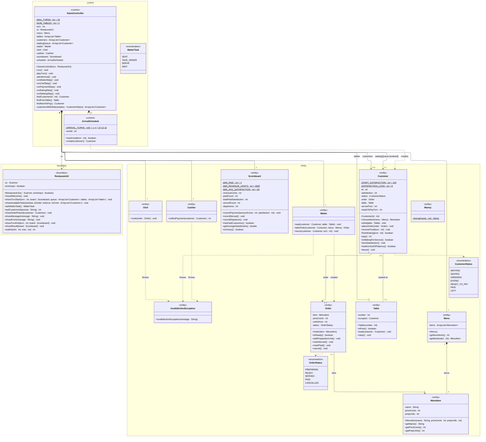
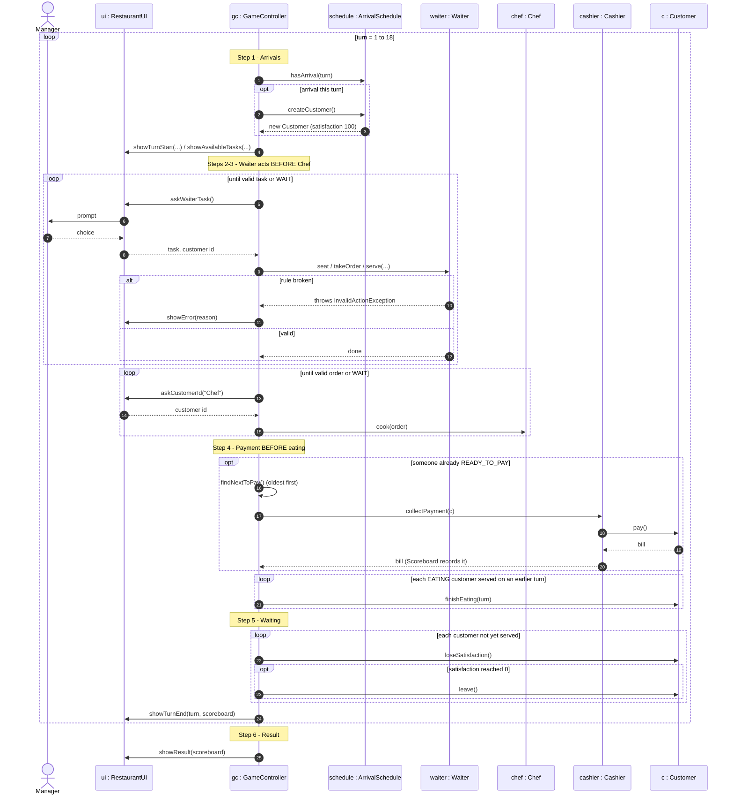

# Stage 1 Design (draft)

Working design for Stage 1 of Restaurant Rush, drawn before implementation.
The final, submitted class diagram is produced in Visual Paradigm from the
Stage 3 code; this draft records the Stage 1 design for the change analysis.

## Class diagram

## Class responsibilities

| Class | Stereotype | Responsibility |
|---|---|---|
| `RestaurantUI` | boundary | Shows the game state and reads the manager's choices. Checks input format only (e.g. "is it a number?"); never checks game rules. |
| `GameController` | control | Runs the 18 turns and the six turn steps in order. Owns the customers, waiting queue, tables, staff and scoreboard, and holds the loops over them. |
| `ArrivalSchedule` | control | Knows which turns have an arrival and creates the arriving customer. |
| `WaiterTask` | enumeration | The four Waiter choices: SEAT, TAKE_ORDER, SERVE, WAIT. |
| `Customer` | entity | Holds satisfaction and lifecycle state; chooses its own food; updates its own state when seated, served, finished eating, paying or leaving. |
| `Order` | entity | Holds the ordered item, the locked price and preparation progress; becomes READY when the last unit is done. |
| `Table` | entity | Knows whether it is free and who sits at it. |
| `Menu`, `MenuItem` | entity | The three dishes with price and preparation units. Menu creates and owns its items. |
| `Waiter`, `Chef`, `Cashier` | entity | Each performs its staff action after checking the rules, and refuses an invalid action with a reason. |
| `Scoreboard` | entity | Records revenue, paid customers, satisfaction at payment, dishes served and departures; computes the average and the victory check. |
| `InvalidActionException` | entity | Carries the reason an action was refused, so the manager can be told and choose again. |
| `Money` | entity | Formats cents as dollars. |

## Turn sequence (sketch)

## Game rules as implemented

- **Food choice:** customer *n* orders menu item number `(n - 1) % 3`, so
  C1 Salad, C2 Burger, C3 Pasta, C4 Salad, C5 Burger, C6 Pasta. The choice
  is shown when the order is placed.
- **Arrivals happen before the start-of-turn display**, so the manager sees
  the new customer before choosing staff tasks.
- **Seating:** the manager may seat any queued customer (not only the first
  in line); the Waiter uses the lowest-numbered free table.
- **Waiter before Chef:** the Chef may cook an order taken this turn. A dish
  the Chef finishes this turn cannot be served until next turn, because the
  Waiter has already acted.
- **Payment before eating:** in step 4 the Cashier first charges the oldest
  customer who was already READY_TO_PAY; only then do customers who were
  served on an earlier turn become READY_TO_PAY. This stops anyone paying in
  the same turn they finish eating.
- **Waiting loss:** at turn end, customers who are WAITING, SEATED or ORDERED
  (including those whose dish is READY but not served) lose 8 satisfaction.
  At 0 they leave: the order is cancelled and the table freed.
