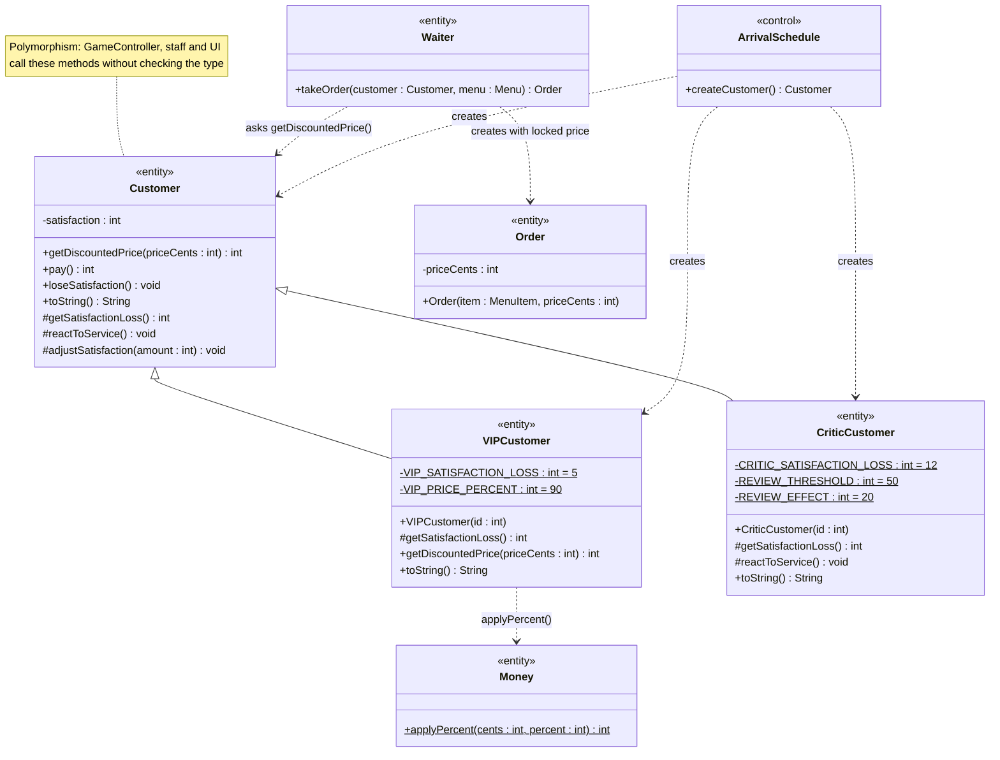

# Stage 2 Design: Customer behaviour

Stage 2 adds VIP and Critic customers (brief §4.2). Decisions are recorded
in `DECISIONS.md` as D15–D19.

## The idea

VIP and Critic customers follow exactly the same order and service flow as
Regular customers; only a few behaviours differ. Each difference is a method
in `Customer` that a subclass overrides, so `GameController`, the staff and
the UI keep calling the same methods and **never check a customer's type**
(polymorphism; brief: "not through a chain of type checks").

| Behaviour | `Customer` (Regular) | `VIPCustomer` | `CriticCustomer` |
|---|---|---|---|
| `getSatisfactionLoss()` per waiting turn | 8 | **5** | **12** |
| `getDiscountedPrice(price)` | full price | **90%** | full price |
| `reactToService()` when paying | nothing | nothing | **≥ 50: +20 (max 100); < 50: −20 (min 0)** |
| `toString()` label | `C1` | `C3 [VIP]` | `C2 [Critic]` |

## Changes (diagram shows only the classes that change)

| File | Change | Why |
|---|---|---|
| `VIPCustomer` (new) | Overrides loss, price and label | D15, D16 |
| `CriticCustomer` (new) | Overrides loss, reaction and label | D15, D16, D17 |
| `Customer` | Adds the four overridable methods; `loseSatisfaction()` uses `getSatisfactionLoss()`; `pay()` calls `reactToService()` first | D16, D17 |
| `Money` | Adds `applyPercent()` for rounding discounts | D3, D18 |
| `Order` | Constructor takes the locked price: `Order(item, priceCents)` | D18 |
| `Waiter` | `takeOrder()` asks the customer for its price | D18 |
| `ArrivalSchedule` | C2 is a Critic, C3 a VIP | D19 |
| **Unchanged:** `GameController`, `Chef`, `Cashier`, `Table`, `Menu`, `MenuItem`, `Scoreboard`, `RestaurantUI` | | The turn controller needs no change |

## Arrivals

| Turn | 1 | 4 | 7 | 10 | 13 | 16 |
|---|---|---|---|---|---|---|
| Customer | C1 Regular | **C2 Critic** | **C3 VIP** | C4 Regular | C5 Regular | C6 Regular |
| Orders | Salad | Burger | Pasta | Salad | Burger | — |

## Expected result of the unchanged Stage 1 victory inputs

| Customer | Satisfaction at payment | Bill |
|---|---|---|
| C1 Regular | 84 | $9.00 |
| C2 Critic | 76 → **96** (good review) | $15.00 |
| C3 VIP | **85** (loses 5 per turn) | **$16.20** (10% off $18.00) |
| C4 Regular | 76 | $9.00 |
| C5 Regular | 76 | $15.00 |

VICTORY: 5 paid, $64.20, average 83.4. (Checked against a test build.)
