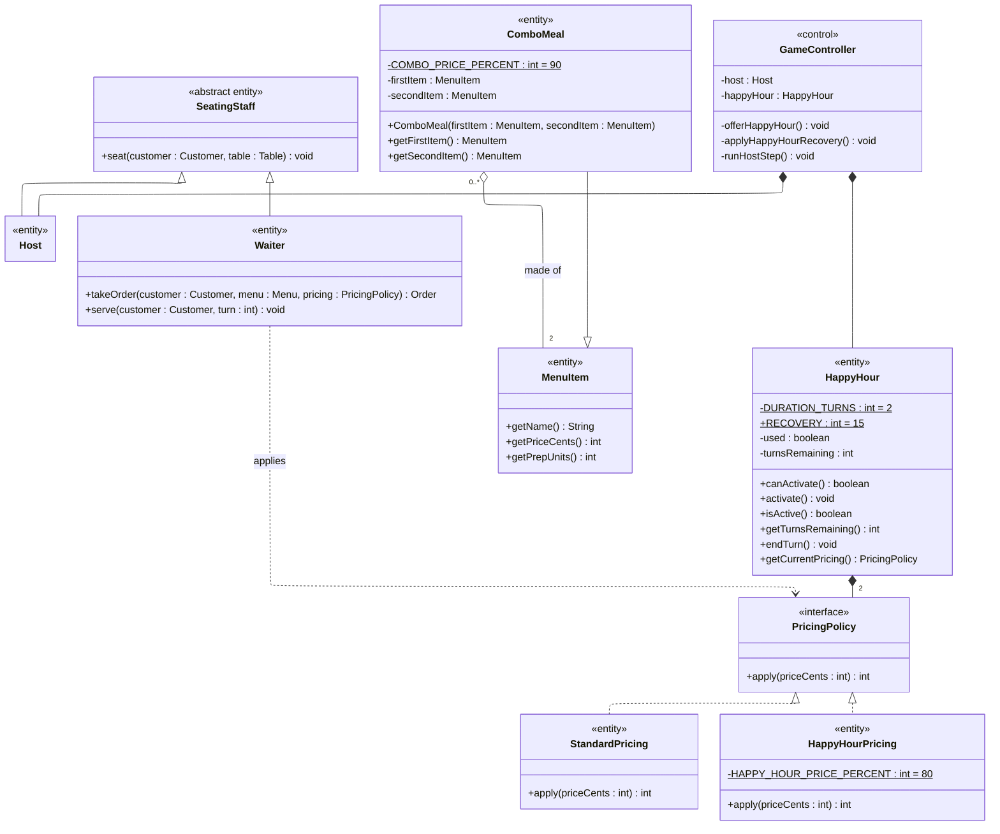

# Stage 3 Design: Host, ComboMeal, Happy Hour

Stage 3 adds three features (brief §4.3). Decisions are recorded in
`DECISIONS.md` as D20–D24.

## The three features

| Feature | Design | Decision |
|---|---|---|
| **Host** | New abstract `SeatingStaff` holds `seat()` (the seating rules, moved from `Waiter`). `Host` and `Waiter` both extend it; the Waiter keeps `takeOrder()` and `serve()`. The Host acts **before** the Waiter, so the Waiter can take that customer's order in the same turn | D20, D21 |
| **ComboMeal** | `ComboMeal extends MenuItem` (a combo *is a* menu item) and holds two `MenuItem`s (*made of*). Name `Salad + Pasta`, units = the sum, price = 90% of the sum. All three pairs are on the menu after the dishes | D22 |
| **Happy Hour** | `HappyHour` entity: activated once, lasts 2 turns, counts down, shown each turn. Orders taken while active are priced by `HappyHourPricing` (20% off) through the `PricingPolicy` interface. Each active turn, waiting customers recover 15 (max 100) | D23, D24 |

## Changes (diagram shows only new and changed classes)

## Turn order

1. Arrival
2. Start-of-turn display (now including Happy Hour's status)
3. **Offer Happy Hour** (only while unused)
4. **Happy Hour recovery** (only while active): +15 for customers waiting for a table or food
5. Available tasks
6. **Host** seats one queued customer (or waits)
7. Waiter, then Chef (unchanged rule: Waiter before Chef)
8. Payment, then eating; waiting; **Happy Hour counts down**; end-of-turn display

## Menu and food choice

The food-choice rule is unchanged: customer *n* orders menu item
`(n - 1) % menu size`. The menu now has six items, so:

| Customer | C1 | C2 Critic | C3 VIP | C4 | C5 | C6 |
|---|---|---|---|---|---|---|
| Orders | Salad $9.00 | Burger $15.00 | Pasta $18.00 | **Salad + Burger** $21.60, 2 units | **Salad + Pasta** $24.30, 3 units | **Burger + Pasta** $29.70, 3 units |

## Pricing order (VIP first, then Happy Hour)

The Waiter locks `pricing.apply(customer.getDiscountedPrice(menuPrice))`
into the Order. Example from the brief: a VIP Burger during Happy Hour is
$15.00 × 0.9 × 0.8 = **$10.80**. Orders taken before or after Happy Hour
keep their price.

## Files

| File | Change | Owner |
|---|---|---|
| `SeatingStaff`, `Host` (new) | Shared seating rules; the Host role | C |
| `Waiter` | Extends `SeatingStaff` (its `seat()` moves there); `takeOrder()` applies the given pricing | C |
| `ComboMeal` (new) | Combo of two menu items | D |
| `Menu` | Adds the three combos | D |
| `RestaurantUI` | Asks whether to activate Happy Hour; shows its status | D |
| `HappyHour`, `PricingPolicy`, `StandardPricing`, `HappyHourPricing` (new) | Happy Hour state and pricing | Lead |
| `Customer` | Adds `recoverSatisfaction()` | Lead |
| `GameController` | Host step, Happy Hour offer, recovery and countdown | Lead |
| **Unchanged:** `Order`, `Chef`, `Cashier`, `Table`, `Scoreboard`, `MenuItem`, `VIPCustomer`, `CriticCustomer`, `Money` | | |

## Expected victory run (`runs/stage3-victory.txt`)

The Host seats each arrival; Happy Hour is activated on turn 7 when the VIP
arrives. Checked against a test build:

| Customer | Order | Price | Satisfaction at payment |
|---|---|---|---|
| C1 | Salad | $9.00 | 92 |
| C2 Critic | Burger | $15.00 | 88 → 100 (good review, capped) |
| C3 VIP | Pasta during Happy Hour | **$12.96** ($18 × 0.9 × 0.8) | 95 (recovered during Happy Hour) |
| C4 | Salad + Burger | $21.60 | 84 |
| C5 | Salad + Pasta | $24.30 | 76 |

VICTORY: 5 paid, $82.86, average 89.4.
