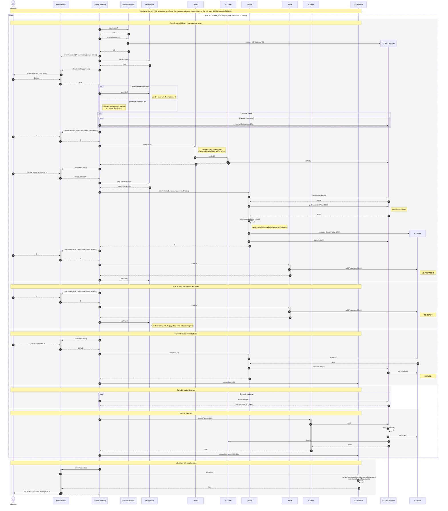

# Final diagrams (Stage 3)

Sources for the diagrams in the report. PNGs: `class-diagram-final.png`, `sequence-diagram.png`. Rendered with Mermaid.

## Class diagram

```mermaid
---
config:
  layout: elk
  elk:
    mergeEdges: true
    nodePlacementStrategy: BRANDES_KOEPF
  class:
    hideEmptyMembersBox: true
---
classDiagram
    direction TB
    namespace boundary {
        class RestaurantUI {
            <<boundary>>
            +showWelcome() void
            +showTurnStart(turn : int, board : Scoreboard, queue : ArrayList~Customer~, tables : ArrayList~Table~) void
            +showAvailableTasks(toSeat : ArrayList~Customer~, toOrder : ArrayList~Customer~, toServe : ArrayList~Customer~, toCook : ArrayList~Customer~) void
            +askWaiterTask() WaiterTask
            +askActivateHappyHour() boolean
            +showHappyHourStatus(happyHour : HappyHour) void
            +askCustomerId(prompt : String) int
            +showOrderPlaced(customer : Customer) void
            +showMessage(message : String) void
            +showError(message : String) void
            +showTurnEnd(turn : int, board : Scoreboard) void
            +showResult(board : Scoreboard) void
        }
    }
    namespace control {
        class ArrivalSchedule {
            <<control>>
            -ARRIVAL_TURNS : int[] = 1, 4, 7, 10, 13, 16$
            -CRITIC_ID : int = 2$
            -VIP_ID : int = 3$
            -nextId : int
            +hasArrival(turn : int) boolean
            +createCustomer() Customer
        }
        class GameController {
            <<control>>
            +MAX_TURNS : int = 18$
            -NUM_TABLES : int = 2$
            -turn : int
            -ui : RestaurantUI
            -menu : Menu
            -tables : ArrayList~Table~
            -customers : ArrayList~Customer~
            -waitingQueue : ArrayList~Customer~
            -host : Host
            -waiter : Waiter
            -chef : Chef
            -cashier : Cashier
            -scoreboard : Scoreboard
            -schedule : ArrivalSchedule
            -happyHour : HappyHour
            +GameController(ui : RestaurantUI)
            +run() void
            -playTurn() void
            -admitArrival() void
            -offerHappyHour() void
            -applyHappyHourRecovery() void
            -runHostStep() void
            -runWaiterStep() void
            -runChefStep() void
            -runPaymentStep() void
            -runEatingStep() void
            -runWaitingStep() void
        }
        class WaiterTask {
            <<enumeration>>
            SEAT
            TAKE_ORDER
            SERVE
            WAIT
        }
    }
    namespace entity {
        class Cashier {
            <<entity>>
            +collectPayment(customer : Customer) int
        }
        class Chef {
            <<entity>>
            +cook(order : Order) void
        }
        class ComboMeal {
            <<entity>>
            -COMBO_PRICE_PERCENT : int = 90$
            -firstItem : MenuItem
            -secondItem : MenuItem
            +ComboMeal(firstItem : MenuItem, secondItem : MenuItem)
            +getFirstItem() MenuItem
            +getSecondItem() MenuItem
        }
        class CriticCustomer {
            <<entity>>
            -CRITIC_SATISFACTION_LOSS : int = 12$
            -REVIEW_THRESHOLD : int = 50$
            -REVIEW_EFFECT : int = 20$
            +CriticCustomer(id : int)
            #getSatisfactionLoss() int
            #reactToService() void
            +toString() String
        }
        class Customer {
            <<entity>>
            -START_SATISFACTION : int = 100$
            -SATISFACTION_LOSS : int = 8$
            -id : int
            -satisfaction : int
            -status : CustomerStatus
            -order : Order
            -table : Table
            -servedTurn : int
            -readyToPayTurn : int
            +Customer(id : int)
            +getId() int
            +getSatisfaction() int
            +getStatus() CustomerStatus
            +getOrder() Order
            +getTable() Table
            +getReadyToPayTurn() int
            +chooseItem(menu : Menu) MenuItem
            +sitAt(table : Table) void
            +placeOrder(order : Order) void
            +receiveFood(turn : int) void
            +finishEating(turn : int) boolean
            +pay() int
            +isWaitingForService() boolean
            +loseSatisfaction() void
            +recoverSatisfaction(amount : int) void
            +hasRunOutOfPatience() boolean
            +leave() void
            #getSatisfactionLoss() int
            +getDiscountedPrice(priceCents : int) int
            #reactToService() void
            #adjustSatisfaction(amount : int) void
            +toString() String
        }
        class CustomerStatus {
            <<enumeration>>
            WAITING
            SEATED
            ORDERED
            EATING
            READY_TO_PAY
            PAID
            LEFT
        }
        class HappyHour {
            <<entity>>
            -DURATION_TURNS : int = 2$
            +RECOVERY : int = 15$
            -used : boolean
            -turnsRemaining : int
            -standardPricing : PricingPolicy
            -happyHourPricing : PricingPolicy
            +HappyHour()
            +canActivate() boolean
            +activate() void
            +isActive() boolean
            +getTurnsRemaining() int
            +endTurn() void
            +getCurrentPricing() PricingPolicy
        }
        class HappyHourPricing {
            <<entity>>
            -HAPPY_HOUR_PRICE_PERCENT : int = 80$
            +apply(priceCents : int) int
        }
        class Host {
            <<entity>>
        }
        class InvalidActionException {
            <<entity>>
            +InvalidActionException(message : String)
        }
        class Menu {
            <<entity>>
            -items : ArrayList~MenuItem~
            +Menu()
            +getNumItems() int
            +getItem(index : int) MenuItem
        }
        class MenuItem {
            <<entity>>
            -name : String
            -priceCents : int
            -prepUnits : int
            +MenuItem(name : String, priceCents : int, prepUnits : int)
            +getName() String
            +getPriceCents() int
            +getPrepUnits() int
            +toString() String
        }
        class Money {
            <<entity>>
            +format(cents : int)$ String
            +applyPercent(cents : int, percent : int)$ int
        }
        class Order {
            <<entity>>
            -item : MenuItem
            -priceCents : int
            -unitsDone : int
            -status : OrderStatus
            +Order(item : MenuItem, priceCents : int)
            +getItem() MenuItem
            +getPriceCents() int
            +getUnitsDone() int
            +getStatus() OrderStatus
            +isReady() boolean
            +addPreparationUnit() void
            +markServed() void
            +markPaid() void
            +cancel() void
            +toString() String
        }
        class OrderStatus {
            <<enumeration>>
            PREPARING
            READY
            SERVED
            PAID
            CANCELLED
        }
        class PricingPolicy {
            <<interface>>
            +apply(priceCents : int) int
        }
        class Scoreboard {
            <<entity>>
            +MIN_PAID : int = 4$
            +MIN_REVENUE_CENTS : int = 4500$
            +MIN_AVG_SATISFACTION : int = 60$
            -revenueCents : int
            -paidCount : int
            -totalPaidSatisfaction : int
            -servedCount : int
            -departures : int
            +recordPayment(amountCents : int, satisfaction : int) void
            +recordServed() void
            +recordDeparture() void
            +getRevenueCents() int
            +getPaidCount() int
            +getServedCount() int
            +getDepartures() int
            +hasPaidCustomers() boolean
            +getAverageSatisfaction() double
            +isVictory() boolean
            +isPaidTargetMet() boolean
            +isRevenueTargetMet() boolean
            +isSatisfactionTargetMet() boolean
        }
        class SeatingStaff["SeatingStaff {abstract}"] {
            <<entity>>
            +seat(customer : Customer, table : Table) void
        }
        class StandardPricing {
            <<entity>>
            +apply(priceCents : int) int
        }
        class Table {
            <<entity>>
            -number : int
            -occupant : Customer
            +Table(number : int)
            +getNumber() int
            +getOccupant() Customer
            +isFree() boolean
            +seat(customer : Customer) void
            +clear() void
        }
        class VIPCustomer {
            <<entity>>
            -VIP_SATISFACTION_LOSS : int = 5$
            -VIP_PRICE_PERCENT : int = 90$
            +VIPCustomer(id : int)
            #getSatisfactionLoss() int
            +getDiscountedPrice(priceCents : int) int
            +toString() String
        }
        class Waiter {
            <<entity>>
            +takeOrder(customer : Customer, menu : Menu, pricing : PricingPolicy) Order
            +serve(customer : Customer, turn : int) void
        }
    }
    class Main {
        +main(args : String[])$ void
    }
    class Exception {
        <<Java library>>
    }
    note for Customer "Encapsulation: satisfaction is private and only<br/>changed through adjustSatisfaction(), which keeps it in 0..100.<br/>Polymorphism: VIPCustomer and CriticCustomer override<br/>getSatisfactionLoss(), getDiscountedPrice() and reactToService()"
    note for PricingPolicy "Polymorphism (DIP/OCP): the Waiter applies whichever<br/>policy it is given; Happy Hour is a new class, not an if"
    note for Menu "Composition: the Menu creates and owns its items;<br/>ComboMeal is-a MenuItem and is made of two (aggregation)"
    note for SeatingStaff "Inheritance: Host and Waiter share one copy of the<br/>seating rules; the Chef and Cashier cannot seat"

    Main ..> RestaurantUI : creates
    Main ..> GameController : creates
    GameController "1" --> "1" RestaurantUI : ui
    GameController "1" *-- "1" Menu : menu
    GameController "1" *-- "2" Table : tables
    GameController "1" *-- "1" Host
    GameController "1" *-- "1" Waiter
    GameController "1" *-- "1" HappyHour
    GameController "1" *-- "1" Chef
    GameController "1" *-- "1" Cashier
    GameController "1" *-- "1" Scoreboard
    GameController "1" *-- "1" ArrivalSchedule : schedule
    GameController "1" --> "0..6" Customer : customers
    GameController "1" --> "0..*" Customer : waitingQueue {ordered}
    Menu "1" *-- "6" MenuItem : items
    Customer "1" --> "0..1" Order : order
    Customer "0..1" -- "0..1" Table : seated at
    Order "0..*" --> "1" MenuItem : item
    Customer --> CustomerStatus : status
    Order --> OrderStatus : status
    ArrivalSchedule ..> Customer : creates
    Waiter ..> Order : creates
    SeatingStaff ..> InvalidActionException : throws
    Chef ..> InvalidActionException : throws
    Cashier ..> InvalidActionException : throws
    InvalidActionException --|> Exception
    RestaurantUI ..> Scoreboard : displays
    RestaurantUI ..> WaiterTask : returns
    Customer <|-- VIPCustomer
    Customer <|-- CriticCustomer
    ArrivalSchedule ..> VIPCustomer : creates
    ArrivalSchedule ..> CriticCustomer : creates
    VIPCustomer ..> Money : applyPercent
    SeatingStaff <|-- Host
    SeatingStaff <|-- Waiter
    MenuItem <|-- ComboMeal
    ComboMeal "0..*" o-- "2" MenuItem : made of
    PricingPolicy <|.. StandardPricing
    PricingPolicy <|.. HappyHourPricing
    HappyHour "1" *-- "2" PricingPolicy
    Waiter ..> PricingPolicy : applies
    HappyHour ..> InvalidActionException : throws
    RestaurantUI ..> HappyHour : displays
    ComboMeal ..> Money : applyPercent
    HappyHourPricing ..> Money : applyPercent
```

## Sequence diagram: a VIP served during Happy Hour

